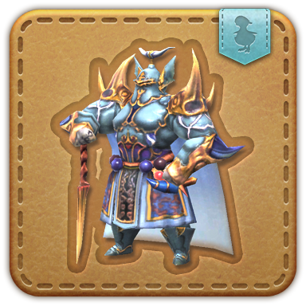

# Sawoo Plugins

Dalamud plugins for FINAL FANTASY XIV by Sayuuryi.

## Install

1. Open Dalamud Settings → Experimental.
2. Under Custom Plugin Repositories, add
   `https://raw.githubusercontent.com/Sayuuryi/SawooPlugins/main/repo.json`
   and click Save.
3. Search for the plugin in the plugin installer.

To try new versions before everyone else, right-click the plugin in the installer and turn on **Receive plugin testing versions**.

## Plugins

### Sawoo Plates

A few extra tools for the Portrait Editor: copy and paste preset codes, a preset library with thumbnails and tags, finer camera, eye and head controls, an alignment grid, and a heads-up when your gear no longer matches your portrait.

Open it with `/splates`, or `/splates config` for the settings.

### Chibi Dancing Mad

Makes Dancing Mad Exdeath and Chaos smaller, with optional Penumbra redraw support.

## Credits

Game structures come from [FFXIVClientStructs](https://github.com/aers/FFXIVClientStructs).

## License

Sawoo Plates is licensed under [AGPL-3.0](LICENSE).
