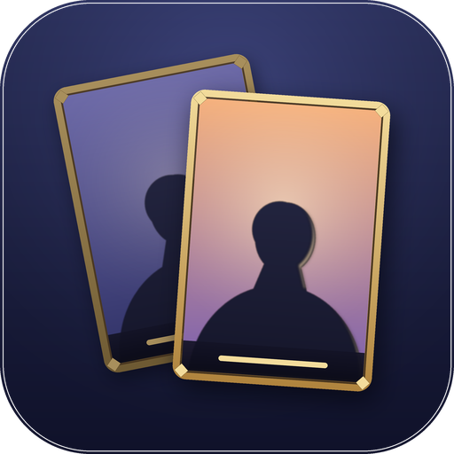

# Sawoo Plates

A Dalamud plugin for FINAL FANTASY XIV that adds a few tools to the Portrait Editor: copy and paste preset codes, a preset library with thumbnails and tags, finer camera, eye and head controls, an alignment grid, and a heads-up when your gear no longer matches your portrait.

## Install

1. Open Dalamud Settings → Experimental.
2. Under Custom Plugin Repositories, add
   `https://raw.githubusercontent.com/Sayuuryi/SawooPlugins/main/repo.json`
   and click Save.
3. Search for **Sawoo Plates** in the plugin installer.

Open it with `/splates`, or `/splates config` for the settings.

To try new versions early, right-click the plugin in the installer and turn on **Receive plugin testing versions**.

## Credits

Game structures come from [FFXIVClientStructs](https://github.com/aers/FFXIVClientStructs).

## License

[AGPL-3.0](LICENSE).
